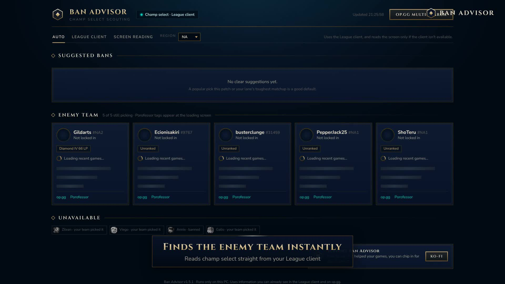
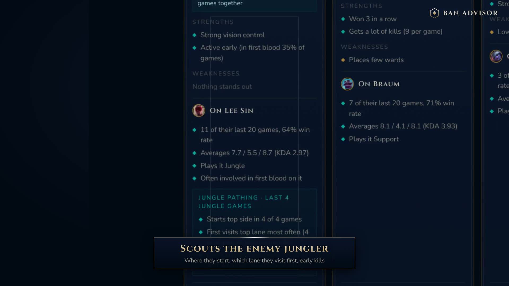

# Ranked 5s Ban Advisor

A free Windows helper for League of Legends champ select. When champ select starts, it finds the enemy team and shows a scouting dashboard in your browser: who to ban, each enemy's strengths and weaknesses, how they play the champion they lock in, and the enemy jungler's usual early path.

**[⬇ Download the latest version](https://github.com/Biscuitables/Ranked-5s/releases/latest)** · Windows 10 / 11 · Free



## Features

- **Suggested bans** based on what each enemy plays most. Recent games count more, and games played with their current teammates count extra.
- **Enemy cards** with rank, role, win rate, KDA, CS per minute, kill participation, most-played champions, strengths, weaknesses and premades.
- **Lock-in study**: how each player performs on the champion they just picked.
- **Jungle pathing** for the enemy jungler: start side, first lane visited, early kills.
- **Porofessor tags** at the loading screen.
- **Win tracking** for your session.
- Works with Chinese, Japanese and Korean names.



## How to use it

1. Download **Ranked5sBanAdvisor.zip** from [Releases](https://github.com/Biscuitables/Ranked-5s/releases/latest), right-click it → **Extract All**.
2. Open League of Legends, then double-click **Ranked5sBanAdvisor.exe**.
3. Windows may show "Windows protected your PC" because the app isn't code-signed. Click **More info** → **Run anyway**.
4. Your browser opens the dashboard. Queue up; it fills in when champ select starts.

The full guide (settings, Riot API key, screen reading, troubleshooting) is in **[docs/USER-GUIDE.md](docs/USER-GUIDE.md)**.

## Privacy and fair play

- Runs only on your PC. The dashboard is served at `http://localhost:8765` and isn't reachable from other computers.
- Only looks up players whose names are already visible to you in the League client. It never reveals hidden players or old Riot IDs.
- Doesn't read or change the game, and never makes picks or bans for you.
- Data comes from your League client, the Riot Games API (optional, with your own key), op.gg and Porofessor.
- Your Riot API key, if you add one, is stored on your PC encrypted for your Windows account.

## Build it yourself

Everything the app runs is in [`src/`](src): `BanAdvisor.ps1` (the app), `index.html` (the dashboard) and `Launcher.cs` (the small tray launcher that becomes the .exe). To build the .exe on Windows, open Command Prompt in the `src` folder and run:

```
C:\Windows\Microsoft.NET\Framework64\v4.0.30319\csc.exe /target:winexe /win32icon:icon.ico /r:System.Windows.Forms.dll /r:System.Drawing.dll /resource:BanAdvisor.ps1,BanAdvisor.ps1 /resource:index.html,index.html /out:Ranked5sBanAdvisor.exe Launcher.cs
```

## Support

The app is free. If it helps your games, you can [buy me a boba on Ko-fi](https://ko-fi.com/biscuitables) or use the **Sponsor** button at the top of this page.

---

Ranked 5s Ban Advisor isn't endorsed by Riot Games and doesn't reflect the views or opinions of Riot Games or anyone officially involved in producing or managing Riot Games properties. Riot Games and all associated properties are trademarks or registered trademarks of Riot Games, Inc.
